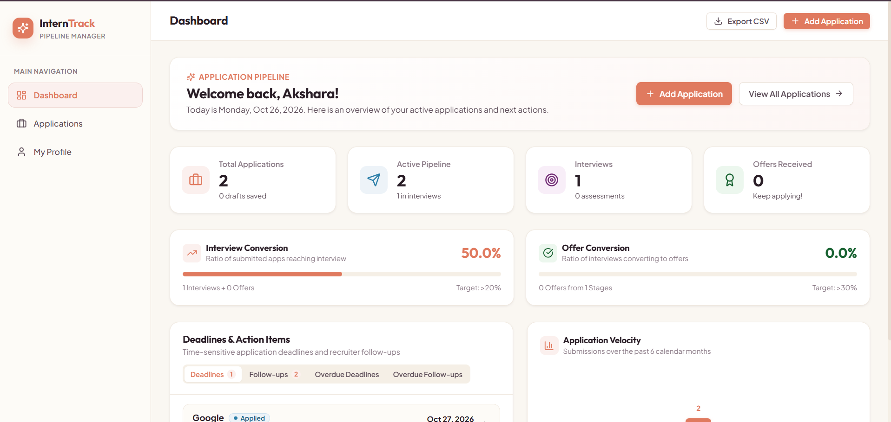
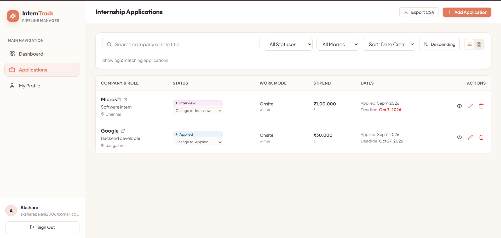
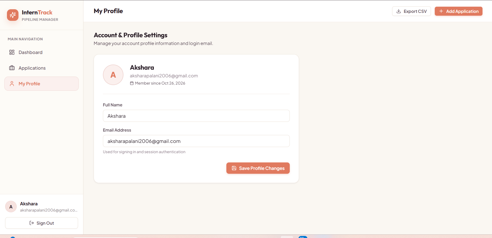

# Internship Application Tracker

A full-stack web application designed to help students organize internship applications, track recruitment progress, manage deadlines, and monitor their internship search in one place.

## Screenshots

### 1. Dashboard



### 2. Applications



### 3. Profile



## Features

- User registration and login
- Dashboard with application statistics and activity
- Add and manage internship applications
- Track application statuses
- Search and filter applications
- Monitor upcoming deadlines
- Manage user profile information
- CSV functionality for application data

## Tech Stack

**Frontend**
- React
- JavaScript
- Vite
- CSS

**Backend**
- Node.js
- Express.js
- REST API

**Database**
- MySQL

**Testing**
- Automated backend tests

## Project Structure

```text
internship-tracker/
├── client/
│   └── src/
│       ├── api/
│       ├── components/
│       ├── context/
│       ├── pages/
│       └── utils/
├── server/
│   ├── database/
│   ├── src/
│   └── tests/
├── screenshots/
│   ├── Dashboard.png
│   ├── Application Start.png
│   └── Profile.png
├── API_CONTRACT.md
├── app.js
├── package.json
├── .gitignore
└── README.md
```

## Getting Started

### Prerequisites

- Node.js and npm
- MySQL
- Git

### 1. Clone the repository

```bash
git clone YOUR_GITHUB_REPOSITORY_URL
cd internship-application-tracker
```

Replace `YOUR_GITHUB_REPOSITORY_URL` with your actual GitHub repository URL.

### 2. Install dependencies

Install the root dependencies:

```bash
npm install
```

Install the frontend dependencies:

```bash
cd client
npm install
```

Install the backend dependencies:

```bash
cd ../server
npm install
```

### 3. Configure environment variables

Create local `.env` files using the provided `.env.example` files.

Configure the required database connection settings and authentication secrets. Keep real credentials private and never commit them to GitHub.

### 4. Set up the database

Create your MySQL database and use `server/database/schema.sql` to create the required tables.

Refer to `server/README.md` for additional setup instructions.

### 5. Run the application

Start the frontend and backend in separate terminals using the scripts defined in their respective `package.json` files.

Frontend:

```bash
cd client
npm run dev
```

Backend:

```bash
cd server
npm run dev
```

If a command is not defined, check the available scripts in the corresponding `package.json`.

## API Documentation

See `API_CONTRACT.md` for the API contract and `server/README.md` for backend setup details.

## Testing

Backend tests are located in `server/tests/`. Run them using the test script defined in `server/package.json`.

## Future Improvements

- Deployment to a production environment
- Enhanced analytics and reporting
- Application reminders and notifications
- Additional application insights

## Author

**Akshara P**

Built to practise full-stack development, REST API design, database integration, and backend testing.
